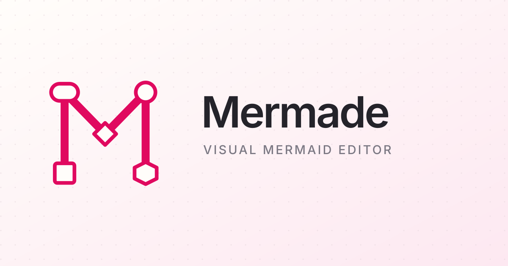
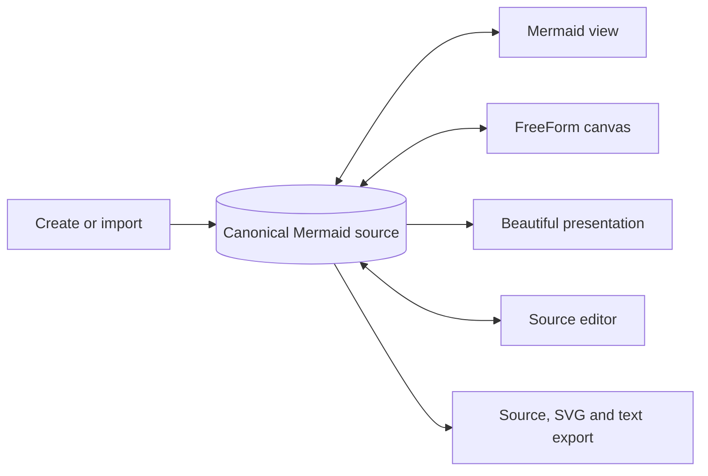
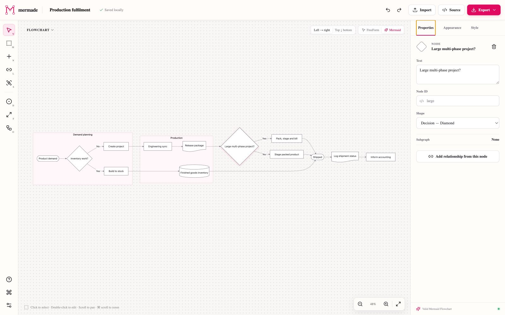
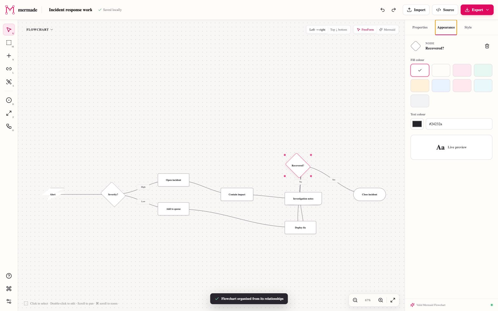
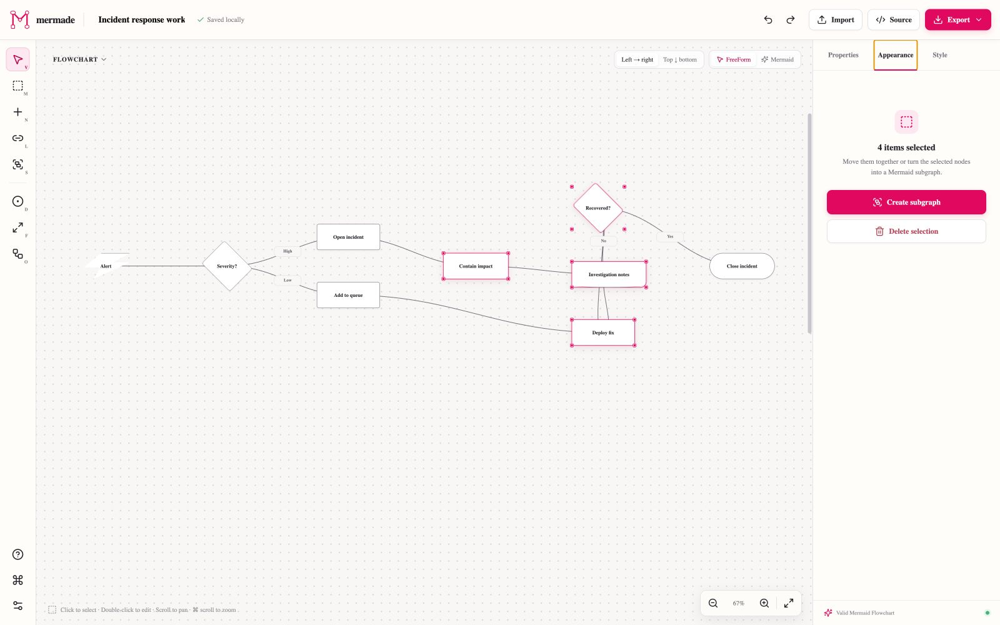
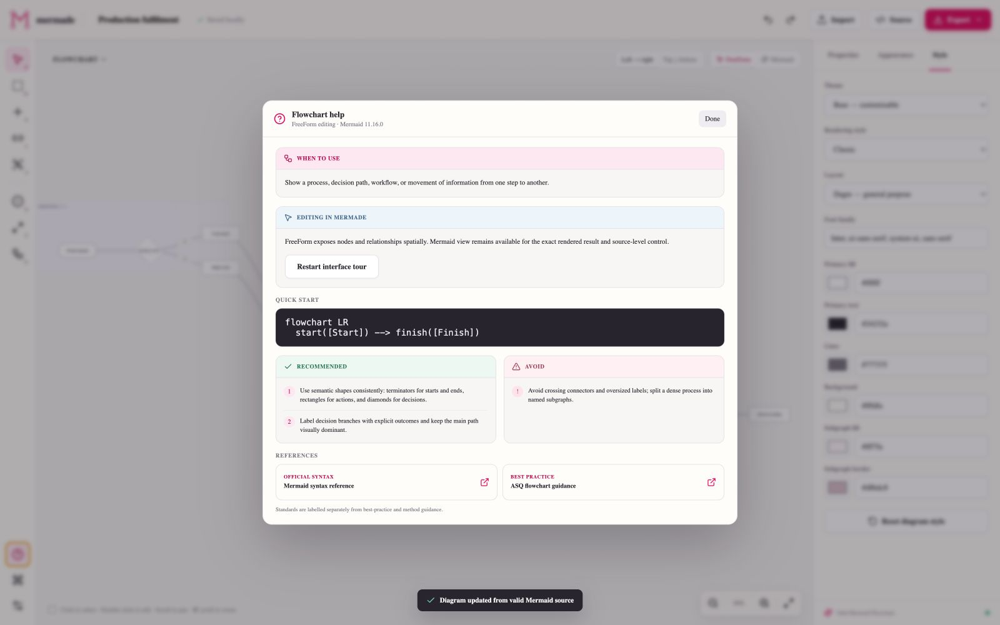

<p align="center">
  
</p>

<p align="center">
  <a href="https://angeladmerkel.github.io/Mermade/"><strong>Open the editor</strong></a>
  · <a href="#local-development">Run locally</a>
</p>

Mermade is a browser-based visual editor for [Mermaid](https://github.com/mermaid-js/mermaid) **flowcharts**. Arrange nodes, edit relationships, group steps into subgraphs, and keep portable Mermaid source. Projects and preferences stay in your browser; no account or server-side document store is required.

## Editing model

Canonical Mermaid source is the document. Visual edits are validated before they replace it, and the FreeForm graph is a projection of that source. Complex syntax that the projection cannot fully represent remains intact.



## Features

- **Mermaid view:** work with the authoritative render. Select nodes and relationships, double-click to edit text, marquee-select, pan, zoom, and fit the chart.
- **FreeForm:** position nodes spatially using Mermaid flowchart shapes. Connect nodes, edit labels and styles, and convert selections into subgraphs.
- **Beautiful:** present the same source with Beautiful Mermaid. Choose adaptive, bundled, or custom palettes; adjust layout density; preview SVG, Unicode, and ASCII; export with a transparent background. Source colours can be enabled explicitly.
- **Source:** edit, validate, copy, undo, and redo the exact Mermaid text. Import `.mmd`, `.mermaid`, `.md`, and `.txt`, including Mermaid fences in Markdown.
- **Appearance:** use Mermaid themes, rendering looks, fonts, and Base-theme palettes as portable frontmatter. Dagre, ELK, and Tidy Tree layouts are available where compatible; Tidy Tree requires a verifiable connected hierarchy without subgraphs.
- **Compatibility:** automatic version selection uses bundled Mermaid 11.16 or Mermaid 10.9 compatibility. Verified repair suggestions handle pasted formatting, missing flowchart declarations, unfinished subgraphs, and shape-version compatibility.
- **Local projects:** create, name, search, switch, duplicate, and delete browser-local documents. Undo history stays within the active document.

## Supported source and older documents

Mermade accepts `flowchart`, legacy `graph`, and `flowchart-elk` declarations, including Mermaid YAML frontmatter and comments. Other Mermaid diagram types are no longer supported for creation, import, editing, or rendering. Structured and Data modes and the diagram-type catalogue have been removed.

Older saved non-flowchart documents remain in the local library. Mermade shows an unsupported-chart notice and keeps their original source available through Source, Copy Mermaid, and `.mmd` export. It does not convert or delete those documents. Applying replacement flowchart source is an explicit edit.

## Feature gallery

| Mermaid and Properties | FreeForm and Appearance |
| --- | --- |
|  |  |
| Select nodes, edit labels, choose purpose-based shapes, and follow relationships. | Reposition nodes and style the active selection. |

| Multi-selection and subgraphs | Flowchart help |
| --- | --- |
|  |  |
| Group selected steps into portable Mermaid subgraphs. | Syntax guidance, recommended practices, and common pitfalls. |

## Keyboard shortcuts

| Shortcut | Action | Shortcut | Action |
| --- | --- | --- | --- |
| `V` | Select | `M` | Marquee select |
| `N` | New node | `Shift` + `N` | New connected node |
| `L` | Link nodes | `S` | Create subgraph |
| `D` | Add decision | `E` | Edit selected text |
| `F` | Fit chart | `Shift` + `F` | Fill chart width |
| `O` | Organise chart | `Delete` | Delete selection |
| `1` | FreeForm | `2` | Mermaid |
| `3` | Beautiful | `Cmd/Ctrl` + `Z` | Undo |
| `Cmd/Ctrl` + `Shift` + `Z` | Redo | Scroll | Pan |
| `Cmd/Ctrl` + scroll | Zoom | | |

## Local development

Node.js 22.13 or newer is required.

```bash
git clone https://github.com/AngelaDMerkel/Mermade.git
cd Mermade
npm install --ignore-scripts
npm run dev
```

Open [localhost:3000](http://localhost:3000).

```bash
npm run test:unit    # pure logic and regression tests
npm run lint         # static analysis
npm test             # production build, unit tests and browser suite
npm run build:pages  # static GitHub Pages export
```

Browser tests use Playwright Core with installed Google Chrome. Set `CHROME_PATH` for a nonstandard installation. Tests use isolated synthetic documents and exercise flowchart declarations, all selectable shapes, themes and layouts, source preservation, async edit races, local-library operations, legacy recovery, all three views, and text/SVG export. See [ARCHITECTURE.md](ARCHITECTURE.md) for responsibilities and invariants.

## Deployment

The GitHub Actions workflow tests the project, creates a static export, and deploys when `main` is pushed. Configure repository **Settings → Pages → GitHub Actions** before the first deployment. `npm run build:pages` produces `out/`, which can also be served by any static web server.

## Credits and provenance

- [Mermaid](https://github.com/mermaid-js/mermaid) supplies canonical parsing and rendering. ELK and Tidy Tree use Mermaid's official layout packages.
- [Beautiful Mermaid](https://github.com/lukilabs/beautiful-mermaid), under its MIT licence, supplies the alternative presentation and text renderers. It credits [mermaid-ascii](https://github.com/AlexanderGrooff/mermaid-ascii) as the foundation of its terminal renderer. Mermade integrates its published API through a source-preserving adapter. Its interface icon is an original Mermaid-pink interpretation of the four-part badge used by Beautiful Mermaid's editor; no upstream brand asset or path data is bundled.
- [Lucide](https://github.com/lucide-icons/lucide) supplies interface icons. The application uses [React](https://react.dev/) and [Next.js](https://nextjs.org/).
- Flowchart help references [Mermaid's syntax documentation](https://mermaid.js.org/syntax/flowchart.html) and [ASQ flowchart guidance](https://asq.org/quality-resources/flowchart). These are educational references, not copied content or endorsements.

Mermade's interface, canvas, interaction model, source adapters, repair workflow, and tests were implemented for this project. No application code was copied or adapted from saketkattu/mermaid-visual-editor or Mermaid's editor examples. Beautiful Mermaid's source was studied to use its API but was not copied into Mermade.

The Connected M identity lives in [public/brand](public/brand) as SVG masters and PNG exports. The primary accent is Mermaid pink (`#E0095F`).

## Licence

Copyright © 2026 Colin Alexander Duffy.

Original source code and project files use the [PolyForm Noncommercial License 1.0.0](LICENSE). This is a **source-available noncommercial licence**, not an OSI-approved open-source licence. Commercial use requires separate permission from the copyright holder. Third-party packages and externally sourced material remain subject to their own licences.

## Roadmap

- Alignment guides, editable edge routing, and node ports for FreeForm
- Reusable named style presets and visual `classDef` editing
- Stronger local-library recovery and cross-tab conflict handling
- A small Docker/nginx distribution for the static editor
